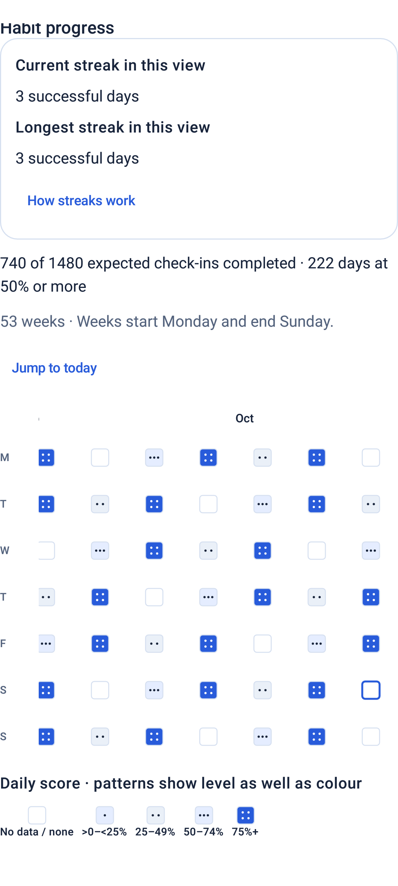
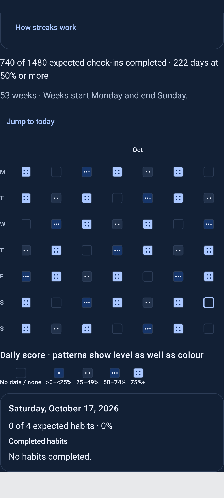
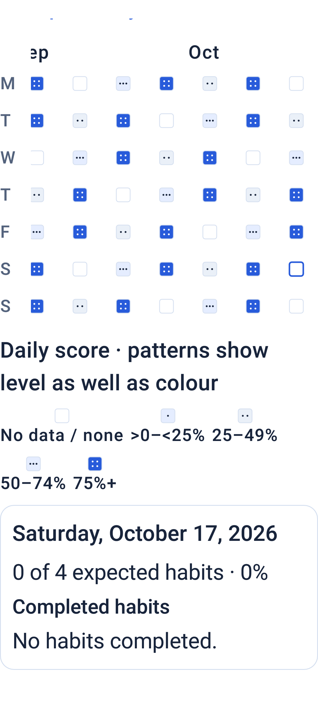

# Phase 3.1 CHECKER REPORT

## 1. Phase and branch/commit hashes

Phase 3.1 only: UX polish and the lazy-list text-wait stability sweep. Branch: `codex/phase-3-1-polish`, created from main merge `b4f9e6bc2804d0db980eb960298b3de99bbf2c51` after the user-authorized merge of accepted PR #7 at expected head `058e77e23f639e6839da7f42dcb0c9aa6f0d6425`.

Required preflight, [main push run 39197711963](https://github.com/raghavkp2006-ux/metis-android-agent/actions/runs/39197711963), attempt 1:

| Build / JVM / lint / Detekt | API26 | API36 |
| --- | --- | --- |
| PASS | PASS | PASS |

All three jobs completed successfully before the polish branch was created. No red main result was retried or bypassed. This report is committed with the implementation and screenshots; obtain that commit with `git log -1 --format=%H -- docs/PHASE_3_1_CHECKER_REPORT.md`. Exact final-head gate links and counts are recorded on the polish PR and in the final delivery copy without creating another unverified Git commit.

## 2. Files changed (path, one-line purpose each)

- `app/src/main/java/dev/metis/agent/presentation/navigation/HabitContributionWorkspace.kt`: newest-week initial scroll, Jump to today, sticky weekday labels, selected-cell semantics, collapsed streak explanation and wrapping legend.
- `app/src/main/res/values/strings.xml`: Jump to today, How streaks work and expanded/collapsed accessibility text.
- `app/src/androidTest/java/dev/metis/agent/FrontendTestNavigation.kt`: shared scroll-to-visible overload for asynchronous eager workspace content; lazy chat results still use the existing action-result helper.
- `app/src/androidTest/java/dev/metis/agent/DecisionScreenTest.kt`: use shared helpers for the empty recommendation response and timeline text.
- `app/src/androidTest/java/dev/metis/agent/FoundationScreenTest.kt`: expose saved foundation rows through the shared scroll helper before retaining existing display assertions.
- `app/src/androidTest/java/dev/metis/agent/TaskActionScreenTest.kt`: four completion/create/undo result waits now synchronize against the exact request result and scroll its lazy chat item into view.
- `app/src/androidTest/java/dev/metis/agent/HabitContributionScreenTest.kt`: retain existing layout/selection/48dp/font/refresh checks and add initial-end scroll, Jump, collapsed rules, chronological traversal, selected-state and un-clipped legend checks.
- `docs/phase31/wait-audit.json`: inventory/classification of every remaining wait, baseline counts and all converted sites.
- `docs/phase31/local-verification.json`: local results, retained initial failure, APK/screenshot hashes and emulator isolation evidence.
- `docs/phase31/heatmap-populated.png`: populated emulator screenshot showing recent weeks.
- `docs/phase31/heatmap-dark.png`: dark-mode emulator screenshot of the current-week grid.
- `docs/phase31/heatmap-font-200.png`: 200% font emulator screenshot of the wrapping legend and selected day.
- `docs/PHASE_3_1_CHECKER_REPORT.md`: this seven-section record.

No schema, migration, domain/calculator/streak/score logic, repository contract, permission, consent, inferred habits table or agent behavior changed. Workflow, dependencies and harness are unchanged. Only the presentation Kotlin file and four UI strings changed in production.

## 3. Commands run (exact) and their real result summaries, including test counts executed/passed/failed/skipped

PowerShell directory: `C:\antigravity_projects\metis-repo-phase-3-heatmap-streaks`. JDK17; SDK `C:\Android\sdk`; `ANDROID_SERIAL` unset. Raw logs: ignored `.local-evidence/phase31/`.

```powershell
git fetch origin
git switch -c codex/phase-3-1-polish origin/main
Remove-Item Env:ANDROID_SERIAL -ErrorAction SilentlyContinue
.\gradlew.bat --no-daemon :app:assembleDebug :app:assembleRelease :app:testDebugUnitTest :app:lintDebug :app:lintRelease :app:detekt :app:assembleCapabilityTest :app:assembleCapabilityTestAndroidTest :app:verifyCapabilityTestApks *> .local-evidence/phase31/verify.log
python -m unittest discover -s tools/legacy_ml -p 'test_*.py' -v *> .local-evidence/phase31/python-legacy.log
python -m unittest discover -s tools/capability_testing -p 'test_*.py' -v *> .local-evidence/phase31/python-harness.log
python tools/legacy_ml/check.py --apks app/build/outputs/apk/debug/app-debug.apk app/build/outputs/apk/release/app-release-unsigned.apk *> .local-evidence/phase31/archive.log
python .local-evidence/phase31/audit_waits.py
```

Full build: `BUILD SUCCESSFUL in 3m 38s`, 174 tasks (63 executed, 111 up-to-date). JVM: **224 discovered, 204 passed, 0 failures/errors, 20 existing skips**. Lint debug/release each: **0 errors, 0 warnings, 13 hints**. Detekt passed. APK identity and legacy archive/packaged-asset checks passed. Python: **8 legacy + 11 harness tests passed**.

```powershell
Start-Process -FilePath C:\Android\sdk\emulator\emulator.exe -ArgumentList '-avd','metis_phase3_api26_clean_20261018','-port','5558','-no-window','-no-snapshot','-no-boot-anim','-memory','4096' -WindowStyle Hidden -RedirectStandardOutput .local-evidence/phase31/emulator.log -RedirectStandardError .local-evidence/phase31/emulator-error.log
python tools/capability_testing/emulator_ready.py --sdk C:\Android\sdk --serial emulator-5558
python tools/capability_testing/harness.py proof --sdk C:\Android\sdk --app app/build/outputs/apk/capabilityTest/app-capabilityTest.apk --test app/build/outputs/apk/androidTest/capabilityTest/app-capabilityTest-androidTest.apk --serial emulator-5558 --output .local-evidence/phase31/proof *> .local-evidence/phase31/proof.log
python tools/capability_testing/harness.py suite --sdk C:\Android\sdk --app app/build/outputs/apk/capabilityTest/app-capabilityTest.apk --test app/build/outputs/apk/androidTest/capabilityTest/app-capabilityTest-androidTest.apk --serial emulator-5558 --proof .local-evidence/phase31/proof/result.json --output .local-evidence/phase31/suite *> .local-evidence/phase31/suite.log
git diff --check
```

Proof passed seed, process-restart and emulator-reboot checks (three single-test invocations), installed APK identity/hash verification, cleanup and unchanged production package state. Boot/package-manager readiness and all three animation scales were verified. Full suite and screenshot hash evidence are recorded in `docs/phase31/local-verification.json`.

The first local suite exposed `HabitContributionScreenTest.heatmapHasFiftyThreeWeeksSelectsCellsAndRemainsReadableAtLargeFont`: `AssertionError: Legend label overflows: No data / none`, stack `Assert.assertTrue(Assert.java:42) -> assertLegendLabelsFit(HabitContributionScreenTest.kt:193) -> heatmapHasFiftyThreeWeeksSelectsCellsAndRemainsReadableAtLargeFont(HabitContributionScreenTest.kt:125)`. This was reported before the layout correction. The suite had 224 passes, one failure and three existing skips; cleanup and production preservation passed. The failure excerpt is retained in `local-verification.json`.

The fixed-width legend entries were replaced by intrinsic-width entries inside the FlowRow. The overflow condition was retained verbatim and given additional layout diagnostics. The same full Gradle command was repeated with log `.local-evidence/phase31/verify-legend.log`: `BUILD SUCCESSFUL in 2m 52s`, 174 tasks (42 executed, 132 up-to-date). The archive APK check was repeated into `archive-legend.log`. Proof and suite were repeated after that source fix with output paths `proof-legend` and `suite-legend`; the suite used `--proof .local-evidence/phase31/proof-legend/result.json`. The fresh proof passed all three single-test checks, reboot, cleanup and production preservation. No test retry wrapper or assertion tolerance change was introduced.

The corrected full local suite passed: **`OK (225 tests)` in 181.872 seconds, 225 passed, 0 failed, 3 existing skips**. The guarded harness verified cleanup, reboot proof and unchanged production state and harvested all four fixtures. The three requested updated PNGs were copied into `docs/phase31/` with SHA256 hashes in `local-verification.json` and visually inspected. Evidence was generated with `python .local-evidence/phase31/record_evidence.py`; the emulator was then shut down using `C:\Android\sdk\platform-tools\adb.exe -s emulator-5558 emu kill` after package cleanup.

Final completion requires build/API26/API36 green on **push**, **PR**, **full rerun attempt 2**, **manual dispatch 1** and **manual dispatch 2**, all at the final unchanged head. The manual dispatches are sequential so the existing branch concurrency group does not cancel a prior verification. Final links/counts are published externally on the PR and in the delivery report, never inferred from an earlier head.

## 4. New tests added and what each proves

No new test methods or ignores. The existing `HabitContributionScreenTest.heatmapHasFiftyThreeWeeksSelectsCellsAndRemainsReadableAtLargeFont` now additionally proves:

- Initial horizontal scroll equals the measured maximum (the current week), with the unchanged 371-cell/53-column report.
- Cell traversal indices remain chronological from 0 through 370.
- The long explanation is absent by default, appears on How streaks work, and disappears on collapse.
- An older cell can still be selected, has the original date/count description and >=48dp targets, and shows the same completed-habit details.
- Jump to today restores both current-week position and today selection; the today cell is visible and marked selected.
- Every legend label is displayed without text overflow and lies inside the viewport at default and 200% font.
- Dark mode, large-font weekday/target bounds and the three refreshed emulator screenshots remain exercised.

All prior assertions are retained. The old first-cell target measurements moved after scrolling that cell into view, because it is intentionally offscreen at the new default end position. The real-repository saved-tick refresh test remains unchanged.

Named assertion inventory against main: Decision **6 -> 6**, Foundation **3 -> 3**, TaskAction **12 -> 12**, and HabitContribution **18 -> 38**. The sweep retains the original display, history, acceptance, persistence and no-mutation assertions.

Wait audit: **91 original calls, 85 remaining; zero remaining unsafe lazy-chat text waits**. `ChatWorkspace` is the sole lazy list in production. Five chat response checks (one Decision and four TaskAction checks) now use `awaitRequestText`, which waits for the exact current action result and scrolls the lazy item into view before display assertion. Decision timeline and Foundation's known helper now use shared eager-container scroll synchronization. Other retained text waits belong to eager workspace Columns, memory filters or dialogs; state, negative/absence, tag and geometry waits are inventoried in `wait-audit.json`. No test, assertion or skip was removed, no timeout was widened, and no test/infrastructure retry wrapper was added.

## 5. Anything NOT RUN or UNVERIFIED

- Physical device `ed01e333`: **NOT RUN**, paused; no command targets it.
- Local API36 instrumentation: **NOT RUN**, no installed local image. CI supplies the required API36 execution evidence.
- Manual TalkBack speech/navigation: **NOT RUN**. Automated traversal, descriptions, selected-state, toggle-state and target/layout checks provide the stated accessibility coverage.
- Final-head CI is the external completion gate; use only its exact SHA/run/attempt results on the PR and in the final delivery report.

## 6. Known risks, shortcuts, TODOs

UI state/layout only: calculations and stored dates are unchanged. The current week is the last week in the existing bounded report; initial scroll is clamped to the measured end. Jump to today restores that end and date selection. Weekday labels stay outside the horizontal scroll container. How streaks work uses saveable expanded state, initially false. Legend entries wrap into multiple rows and grow with font scale.

The 200% screenshot focuses on the complete wrapped legend and selected-day details; populated/dark captures show the recent-week grid. Screenshots are actual API26 Compose emulator captures using synthetic records. The 2.0 font scale is a Compose density override. The existing harness still harvests its four allowlisted fixture names; the three requested updated views are retained under `docs/phase31/`.

No Gradle connected*, install* or uninstall* task was invoked. The harness uses only explicit emulator serials and the two allowlisted capability-test packages, with APK attestation, proof and production-preservation checks. The physical device remains untouched.







## 7. Open questions for me

None for scope. Stop after the exact final-head expanded CI gate is green and its counts are reported. Leave the polish PR for review. Phase 4 has not started.
