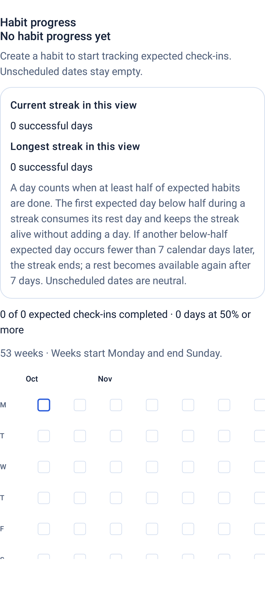
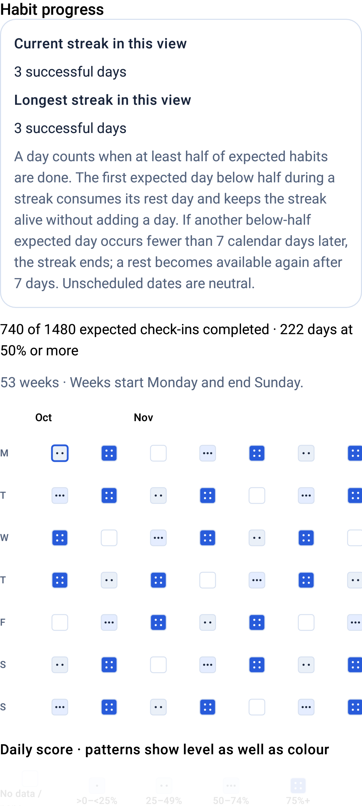
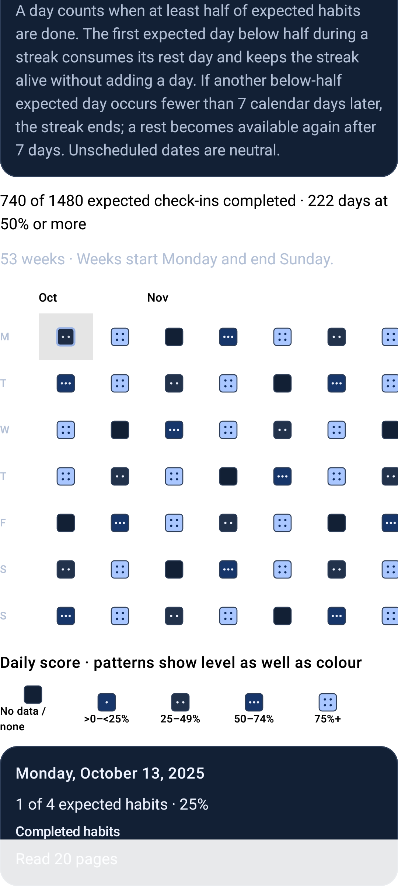
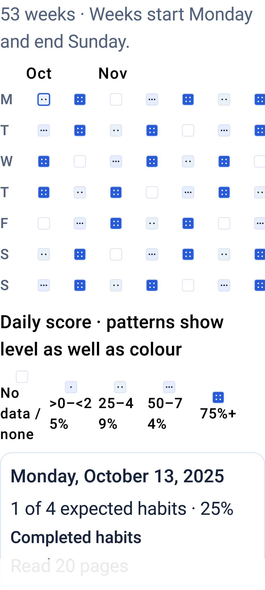

# Phase 3 CHECKER REPORT

## 1. Phase, base, branch, and review

Phase 3 adds the contribution heatmap and streak summary. The branch is `codex/phase-3-heatmap-streaks`, created from updated `main` at `ed8b2c48d83b82c0ae11dffdb697139ded8f378f` (PR #6). Feature implementation is `604b38aa3f288eb51a713d60fcca62239b41f50f`; the final API 26 test synchronization fix is `909aba13501bce5884869c740e0ab61ab43ff2f9`. The branch also includes prerequisite API 26 fixture synchronization commit `45384fd1f617e48b6391a5aab9e2ee14a8b79d15`.

Review PR: [#7 — Phase 3: contribution heatmap and streaks](https://github.com/raghavkp2006-ux/metis-android-agent/pull/7).

## 2. Changed files and scope

- `app/src/main/java/dev/metis/agent/domain/discipline/HabitContribution.kt`: pure score, intensity, 53-week range, totals, and streak calculation.
- `app/src/main/java/dev/metis/agent/presentation/navigation/HabitContributionViewModel.kt`: bounded, read-only repository loads and clock/zone refresh handling.
- `app/src/main/java/dev/metis/agent/presentation/navigation/HabitContributionWorkspace.kt`: accessible heatmap, legend, stats, selected-day details, and loading/error/empty states.
- `app/src/main/java/dev/metis/agent/presentation/navigation/HabitWorkspace.kt` and `app/src/main/res/values/strings.xml`: add the progress section and its strings.
- `app/src/test/java/dev/metis/agent/HabitContributionCalculatorTest.kt`: fixed-clock/zone JVM boundary and rule tests.
- `app/src/androidTest/java/dev/metis/agent/HabitContributionScreenTest.kt`: emulator Compose rendering, selection, accessibility-target, large-font, and screenshot test.
- `tools/capability_testing/harness.py`: pulls only the four named Phase 3 PNGs from the synthetic capability-test package into the emulator test artifact before cleanup.
- `docs/phase3/`: four API 26 emulator screenshots and full before/after package snapshots.
- `app/src/androidTest/java/dev/metis/agent/MemoryEditorScreenTest.kt` is changed in prerequisite commit `45384fd`: after seeding two saved rows, the test waits for repository persistence, explicitly reloads the records view model, and verifies both rows before navigation. Existing UI assertions remain.
- `app/src/androidTest/java/dev/metis/agent/HabitCheckinScreenTest.kt` adds a wait for the restored habit's delete control to enter Compose semantics before scrolling to it. The existing archive/restore/delete actions and assertions remain intact.

There is no schema or migration change, no new permission, no chat/agent surface change, and no change to the existing `habits` table. Phase 3 reads only through the Phase 1 `DisciplineRepository` range methods; it never accesses a DAO.

## 3. Calendar, score, intensity, and streak rules

The calculator derives local today from an injected `Clock` and `ZoneId`. It requests the same inclusive `DisciplineDateRange` for habits and check-ins: 371 dates arranged Monday-first as 53 weeks, ending on the Sunday of the current local week. This is within the repository's 400-date bound. Habit start dates are inclusive, cadence masks determine expected weekdays, and `archivedAt` is exclusive.

A past or current date with expected habits scores `completed expected habits / expected habits`. A date with no expected habits and all future dates have no score. Intensity 0 means no data or zero completed; levels 1–4 are respectively `>0–<25%`, `25–<50%`, `50–<75%`, and `≥75%`. The legend documents each band, and cell patterns add one, two, three, or four dots for levels 1–4.

A streak day has at least half of that date's expected habits completed (`completed × 2 ≥ expected`). An expected day below half consumes the available rest day: it preserves the run but does not add to its successful-day count. A second below-half expected day breaks the run if it occurs fewer than seven calendar days after the prior rest day; a rest is available again at a seven-day separation. Dates with no expected habits are neutral and neither consume nor break a streak. Current and longest streaks count only qualifying days. Totals cover completed/expected habit check-ins and qualifying days through local today; future dates are excluded.

Saved local dates are used as recorded; timezone changes do not rewrite them. The view model reloads on resume and schedules refresh at the next local midnight.

## 4. UI and accessibility

The view renders 53 week columns by 7 weekday rows, Monday first, with month labels (including the first partial month), an intensity legend, current/longest streaks, totals, and a selected-date card listing completed habits. Empty, loading, and unreadable-key/error states use existing design-system patterns.

Every cell has a date-and-count content description, such as “Mon 12 Oct, 1 of 4 habits”. The heatmap is a TalkBack traversal group with chronological cell order. Color is reinforced by dot patterns and a textual legend. Each interactive cell has a 56 dp column width and at least a 48 dp height. The Compose test checks cell dimensions at normal and 200% font scale, weekday-row fit, selection details, light/dark themes, and the 371-cell/53-column layout.

## 5. Local verification and skips

With `ANDROID_SERIAL` unset, this non-device Gradle command completed successfully:

```powershell
.\gradlew.bat --no-daemon :app:assembleDebug :app:assembleRelease :app:testDebugUnitTest :app:lintDebug :app:lintRelease :app:detekt :app:assembleCapabilityTest :app:assembleCapabilityTestAndroidTest
```

The local build reported `BUILD SUCCESSFUL`. JVM XML totals are 219 tests discovered, 199 passed, 0 failures, 0 errors, and 20 pre-existing skipped tests. `HabitContributionCalculatorTest` contributes 12 passed tests and 0 skips. Debug and release lint each report 0 errors, 0 warnings, and 13 informational hints. Detekt reports 0 findings.

The APK identity verifier passed for `dev.metis.agent.capabilitytest` and its isolated instrumentation package. On a fresh API 26 emulator (`emulator-5558`, Android 8.0.0), the guarded proof and full suite passed before the final test synchronization adjustment. After the adjustment, the guarded proof and full suite were rerun successfully: 224 tests passed, 3 existing instrumentation skips, 0 failures. The heatmap test verified 371 cells, 53 week columns, accessible description/selection, 48 dp targets, and readability at 200% font scale. Production `dev.metis.agent` was absent before and after; both synthetic packages were cleaned up.

## 6. CI preflight and final gate

Before Phase 3, run [39112134248](https://github.com/raghavkp2006-ux/metis-android-agent/actions/runs/39112134248) on Phase 1 merge `297b282` failed at API 26 “Run instrumented tests”. Its report identifies `derivedFilterAndExpiryReviewNeverEditProvenanceOrDeleteWithoutConfirmation` in `MemoryEditorScreenTest` and the error `ComposeTimeoutException: Condition still not satisfied after 10000 ms` while waiting for the derived saved row to appear. The API 26 isolation proof passed. This was a fixture-loading synchronization race: the test navigated before the records view model had loaded the two rows it had just seeded.

Run [39121683094](https://github.com/raghavkp2006-ux/metis-android-agent/actions/runs/39121683094) on `ed8b2c4` concluded failure: build/unit/lint/static analysis and API 36 passed; API 26 failed in instrumented tests. The prerequisite synchronization fix was then verified by run [39123435254](https://github.com/raghavkp2006-ux/metis-android-agent/actions/runs/39123435254), where build/unit/lint/static analysis, API 26, and API 36 all passed. The same API 26 test therefore passed after deterministic fixture loading was added; no production behavior or CI check was weakened.

The first Phase 3 CI workflow for commit `604b38a` is [run 39126543813](https://github.com/raghavkp2006-ux/metis-android-agent/actions/runs/39126543813). Build/unit/lint/static analysis and API 36 passed; API 26 failed in `archiveRestoreAndDeleteFlow` (`HabitCheckinScreenTest`) because `performScrollTo()` could not find the restored habit's `habit_delete_<id>` semantics node. The repository wait had already observed the restored row, so the remaining race was Compose rendering the updated row. This is evidenced as an instrumentation synchronization timing issue, not a product failure: the test now waits for that UI node to appear before interacting with it, without removing assertions or weakening a check. The updated full API 26 suite passed locally as recorded above. The final code/test commit `909aba1` passed all three required jobs in both [push run 39139453234](https://github.com/raghavkp2006-ux/metis-android-agent/actions/runs/39139453234) and [PR run 39139456980](https://github.com/raghavkp2006-ux/metis-android-agent/actions/runs/39139456980): build/unit/lint/static analysis, Android smoke tests API 26, and Android smoke tests API 36. This report update is documentation-only and does not change application code.

## 7. Emulator evidence, package boundaries, and phase stop

Physical device `ed01e333` remained paused and was not contacted. No Gradle `connected*`, `install*`, or `uninstall*` task was invoked in this Phase 3 work. A read-only `tasks --all` inventory shows those tasks exist (`app:installDebug`, capability-test install/uninstall tasks, `app:uninstallAll`, and connected test/check tasks); listing them did not execute them. The saved PowerShell history at `C:\Users\ragha\AppData\Roaming\Microsoft\Windows\PowerShell\PSReadLine\ConsoleHost_history.txt` records seven `installDebug` invocations (including one `clean installDebug`) in the separate `signalchain-android` project, five `adb install -r` debug installs, three SignalChain release installs, and one `adb uninstall com.signalchain.app`. It contains no explicit `adb -s ed01e333`, `ANDROID_SERIAL`, `dev.metis.agent`, or Gradle `connected*`/`uninstall*` invocation. The historical ADB install commands omit `-s`, so that saved history cannot establish which device ADB selected then; none of their surrounding project paths or package names identify Metis. No shell-history evidence explains the missing `dev.metis.agent` package, and this report does not claim which device received those older unqualified SignalChain installs.

The existing API 26 AVD was not reused because a read-only package listing showed pre-existing production and synthetic packages; it was left unchanged. The local verification instead used a fresh API 26 emulator and the APK-attested capability-test harness. Only `dev.metis.agent.capabilitytest` and `dev.metis.agent.capabilitytest.test` were installed by that harness; cleanup passed, and the production package was absent before and after. Full `pm list packages` and `pm path dev.metis.agent` outputs for the final proof/suite sessions are recorded in [the before snapshot](phase3/emulator-api26-phase3fix-before.txt), [the pre-suite snapshot](phase3/emulator-api26-phase3fix-before-suite.txt), and [the after snapshot](phase3/emulator-api26-phase3fix-after-suite.txt). The original Phase 3 session snapshots remain at [before](phase3/emulator-api26-before.txt) and [after](phase3/emulator-api26-after.txt).

All screenshots below were captured by the API 26 emulator Compose test from synthetic in-memory records. The 200% image uses a 2.0 Compose font-scale override. The harness extracted the four named screenshots before uninstalling the synthetic test packages.









Phase 3 ends here. Phase 4 has not been started.
